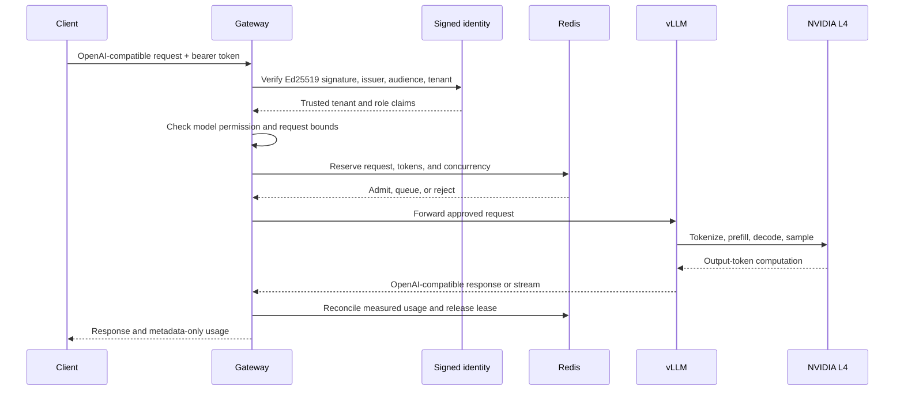

# AI Infrastructure Engineering Handbook

This handbook explains the systems behind the single-GPU inference lab in plain
English. It connects model behavior to Linux, GPU hardware, cloud resources, gateway
controls, and operations. It is a learning guide, not proof that a GPU workload has
run.

## Evidence labels used here

- **Implemented:** source code or configuration exists in this repository.
- **Local evidence:** a command or test ran on a local workstation or a GitHub-hosted
  local end-to-end runner.
- **Planned:** the steps are documented but have not been executed.
- **L4 evidence pending:** only a real, authorized NVIDIA L4 session can prove it.

The project currently has CPU ONNX execution evidence and static GPU preparation.
Until an approved L4 run occurs, this handbook does not claim CUDA computation, vLLM
inference, GPU metrics, GPU benchmark results, GPU recovery, or successful cloud
deployment.

## 1. The request path

The goal is a shared, one-GPU service with application-level tenant controls:



Redis is shared state between two gateway processes on one EC2 host. It lets both
processes enforce the same logical limits. It is not a high-availability database in
this lab, and it does not divide the GPU into secure hardware partitions.

## 2. CPU and GPU computing

A CPU is designed to run a small number of complex instruction streams with strong
branching and low-latency access to system memory. A GPU is designed to run many
similar arithmetic operations at once. A GPU is useful when a job can be expressed as
large amounts of parallel work, as in matrix multiplication for neural networks.

The GPU does not make every program faster. Sending a small job to the GPU can cost
more than doing it on the CPU because data must be copied over PCI Express (PCIe), a
kernel must be launched, and the GPU may need to synchronize before results can be
read. GPU acceleration is most useful when the arithmetic workload is large enough to
repay those costs.

### The NVIDIA L4 in this project

The selected AWS `g6.xlarge` has one NVIDIA L4, 4 virtual CPUs, and 16 GiB of host
memory. AWS lists 22 GiB of GPU memory for this instance; this is often described as
the 24 GB L4. The 22 GiB figure is the relevant planning number for model capacity.
The instance is a virtual machine: AWS manages the physical host. This project does
not demonstrate bare-metal control.

GPU memory stores model weights, activations, CUDA work buffers, communication data,
and the key/value cache used during text generation. A GPU can report high memory
usage even when arithmetic utilization is low, or high utilization while memory is
close to full. Both measurements matter.

### Streaming multiprocessors and execution units

An NVIDIA GPU contains many **streaming multiprocessors (SMs)**. An SM schedules
groups of GPU threads and contains arithmetic units, registers, and shared memory.
Ordinary CUDA cores execute many scalar operations. Tensor Cores accelerate supported
matrix operations, including mixed-precision formats commonly used for neural
networks.

CUDA organizes work as:

1. A **thread** performs one logical piece of work.
2. A **warp** is a group of threads scheduled together; NVIDIA GPUs commonly use
   groups of 32.
3. A **block** groups threads that can cooperate through shared memory and barriers.
4. A **grid** is the collection of blocks launched for one kernel.

If threads in a warp take different branches, the hardware may execute the branch
paths in sequence for different subsets of that warp. This is called **warp
divergence**. It can reduce the benefit of parallel execution.

### GPU memory hierarchy

- **Registers** are the fastest per-thread storage. Each SM has a limited register
  budget; using too many registers can reduce how many thread blocks run together.
- **Shared memory** is a small, fast memory that threads in one block can share.
- **Global memory** is the large GPU memory that stores model weights and tensors.
  It has much higher bandwidth than host memory but more latency than registers.
- **Host memory** is system RAM owned by the EC2 guest. Moving data between host and
  GPU memory over PCIe takes time and should be measured separately.

An optimization can be **compute-bound** when arithmetic throughput is the limit, or
**memory-bound** when moving data is the limit. Matrix multiplication is often
compute-heavy; operations that repeatedly read large tensors may be memory-bandwidth
limited.

## 3. GPU software layers

The terms below describe different layers. A compatible stack is a chain of contracts;
“CUDA 13” alone does not prove that every layer can work together.

| Layer | What it does | How this project checks it |
| --- | --- | --- |
| Physical GPU | L4 accelerator installed in the AWS host | EC2 instance type and hardware inventory |
| Guest device exposure | Makes the GPU visible inside the Ubuntu VM | `lspci`, `/dev/nvidia*`, `nvidia-smi -L` |
| NVIDIA kernel driver | Controls the GPU from the Linux kernel | `lsmod`, `nvidia-smi`, driver version |
| CUDA driver API | Driver interface used by CUDA programs | CUDA sample and container execution |
| CUDA runtime libraries | Libraries that execute compiled CUDA code | Container runtime and PyTorch checks |
| CUDA Toolkit | Developer tools, headers, and libraries | `nvcc --version`; compile the vector-add sample |
| CUDA compiler | Translates CUDA C++ into device code | Compile and run the project kernel |
| GPU-enabled framework | Provides tensor operations above CUDA | `torch.cuda.is_available()` and synchronized math |
| NVIDIA Container Toolkit | Passes device access and driver libraries into containers | Run a GPU-enabled container and inspect its device |
| Docker runtime | Starts and isolates the application container | Docker configuration and Compose profile |
| Device nodes | Linux interfaces used by programs and containers | Inspect `/dev/nvidia*` on host and container |

The **driver** and **CUDA Toolkit** are not the same thing. `nvidia-smi` reports the
driver and the highest CUDA API level it supports; it does not prove that the
corresponding Toolkit is installed. `nvcc --version` reports the installed compiler
toolkit. A container can carry CUDA user-space libraries and still depend on the host
driver to access the GPU. This is why the project checks each layer separately.

For running a prebuilt vLLM image, a full host CUDA compiler is generally unnecessary:
the image contains the libraries it was built to use. This project installs the
Toolkit anyway for the hands-on CUDA lab. The host compiler is an educational and
development requirement, not a runtime requirement for every production inference
host.

## 4. CUDA programs and performance

A CUDA **kernel** is a function executed by many GPU threads. In the vector-add lab,
each thread adds one pair of array elements. In matrix multiplication, each output
element is formed from a dot product of one row and one column.

Use repeated measurements, warm-up iterations, and explicit synchronization. GPU
operations are asynchronous: Python can return before the device finishes the work.
Timing only the Python call can therefore report launch time instead of computation
time. CUDA events measure work on the device timeline; synchronization waits for the
GPU before reading the result.

The project separates these measurements:

- CPU compute time.
- GPU kernel time after warm-up.
- Host-to-device copy time.
- Device-to-host copy time.
- End-to-end time including copies and synchronization.

**Mixed precision** uses formats such as FP16 or BF16 for some calculations. These
formats use fewer bits than FP32 and can reduce memory traffic or use Tensor Cores.
They also have a smaller numeric range or precision, so correctness and stability must
be measured. Quantization goes further by representing weights with fewer bits; it
can save memory and bandwidth, but may change quality and runtime support.

Nsight Systems shows a timeline across CPU threads, CUDA launches, copies, and device
work. Nsight Compute analyzes individual kernels and their hardware counters. Some
counters may be unavailable in a virtualized cloud environment or without elevated
permissions. Record a missing counter as a limitation instead of inventing a result.

## 5. Language models

A **neural network** is a series of learned mathematical operations. Its **parameters**
are the learned values; **weights** are the tensors containing those values. A model
with 1.5 billion parameters has roughly 1.5 billion learned scalar values, but the
memory required also depends on their numeric format and runtime buffers.

**Training** changes weights by comparing predictions with examples, computing an
error signal, and applying an optimizer. **Fine-tuning** continues training from an
existing model with a narrower dataset or objective. **Inference** uses the trained
weights to produce predictions; it should not update them. This project serves a
pretrained model for inference. Its evaluation and release code does not train or
fine-tune model weights.

A **transformer** processes a sequence of tokens using attention and feed-forward
layers. A **tokenizer** maps text to token IDs. A token may be a word, part of a word,
punctuation, or another text fragment. Token counts therefore do not equal word counts.
The model converts token IDs to **embeddings**, numeric vectors that carry learned
information about each token and its position.

### Attention and the key/value cache

For each token and attention head, a transformer computes a **query**, **key**, and
**value** vector. The query asks what prior information is relevant. Keys describe
prior token positions; values hold information that attention can combine. Attention
compares a query to prior keys, assigns weights, and combines the corresponding values.

During text generation, the input prompt is processed once during **prefill**. The
model stores the keys and values for those prompt tokens. During **decoding**, each new
token is processed using those saved values plus the newly generated token's values.
Without a **key/value (KV) cache**, the server would recalculate the attention state for
all prior tokens at every decoding step. The cache avoids that repeated work.

The cache consumes GPU memory. A rough per-sequence formula is:

```text
KV bytes ≈ 2 × layers × sequence_tokens × KV_heads × head_dimension × bytes_per_value
```

The factor of two is for keys and values. Total KV memory grows with context length
and the number of simultaneous sequences. Longer prompts and more concurrent requests
can therefore reduce capacity even when the model weights fit.

**PagedAttention** manages KV memory in blocks rather than requiring one large
contiguous allocation per request. This helps reduce fragmentation and lets the server
share GPU capacity across active requests. **Continuous batching** adds newly arriving
requests to a running batch as other requests finish; it improves utilization compared
with waiting for a fixed batch to complete. These techniques improve sharing, but they
do not create more physical GPU memory.

### Weight memory and model size

A rough lower bound for weight storage is:

```text
weight_bytes ≈ parameter_count × bits_per_parameter ÷ 8
```

For example, 1.5 billion BF16 parameters use approximately 3.0 billion bytes before
runtime overhead, CUDA graphs, activations, and the KV cache. A 7 billion parameter
BF16 model is roughly 14 billion bytes before those costs. Real capacity must be
measured with the exact model, context, precision, and serving concurrency. This
formula is a planning estimate, not a deployment guarantee.

The lab starts with `Qwen/Qwen2.5-1.5B-Instruct`, pinned to a reviewed revision in the
host manifest. The model license and safetensors digest are recorded in the research
notes; both must be rechecked before download. The later 7B and quantized experiments
are conditional on memory and quality results. Never assume multiple large models can
remain loaded at once on a single L4.

### Inference lifecycle

1. The client sends a prompt and generation settings.
2. The gateway authenticates the signed identity, checks the tenant's model grant,
   validates input/output bounds, and reserves shared admission.
3. The tokenizer converts text to token IDs.
4. vLLM performs prefill and populates the KV cache.
5. The server repeatedly decodes and samples the next token.
6. Output tokens are streamed or returned together.
7. The gateway reconciles actual token usage where available, records metadata, and
   releases the request's quota/concurrency reservation.

**Temperature** changes the randomness of token selection. **Top-p** limits sampling
to a nucleus of candidate tokens whose cumulative probability reaches a threshold.
They affect output behavior but do not change model weights. Evaluation should pin
these settings when comparing candidates.

## 6. vLLM serving and request metrics

vLLM is a model-serving engine designed to run many inference requests efficiently on
GPUs. Its OpenAI-compatible API lets existing clients call endpoints such as
`/v1/chat/completions`. “OpenAI-compatible” describes the HTTP schema; it does not
mean that the server uses OpenAI infrastructure.

**Time to first token (TTFT)** measures how long a client waits before receiving the
first output token. **Time per output token (TPOT)** measures the average delay between
generated tokens. **Inter-token latency** measures each gap between tokens. **End-to-end
latency** covers the entire request. These separate user-perceived waiting for prefill
from the speed of decoding.

**Throughput** may be requests per second or tokens per second. Always state which
tokens are counted: input, output, or both. A server can increase aggregate token
throughput while making each user's latency worse. Report P50, P95, and P99: the median,
95th percentile, and 99th percentile respectively. Tail percentiles show slow requests
that an average can hide.

**Cold start** includes container startup, model download/cache validation, and weight
loading. **Warm inference** measures requests after the model is ready. Keep these
results separate. A readiness endpoint should not report ready until the model and
backend can serve requests.

## 7. Tenant identity, quotas, and shared state

An **Ed25519 signature** proves that a token was signed by the holder of a private key.
The gateway verifies the signature with the public key and checks issuer, audience,
expiry, role, and tenant. A caller-supplied `X-Tenant` header is not an identity source.
The authenticated tenant comes from verified claims.

The gateway checks that a tenant may use the requested model before reserving quota.
It then applies:

- request-rate limits;
- input and output token limits;
- concurrent-request limits;
- bounded waiting queues;
- timeouts and cancellation;
- actual-usage reconciliation when the runtime reports usage.

Redis Lua scripts update the shared admission state atomically. A reservation gets a
lease so a crashed gateway cannot hold concurrency forever. The owner renews a lease
for long-running requests and releases it on success, error, or cancellation. Redis
outage must fail closed: the gateway cannot safely assume unlimited capacity or guess
whether another replica has already admitted the tenant.

Three kinds of isolation must not be confused:

| Kind | Meaning | What this lab proves |
| --- | --- | --- |
| Authentication | Verifies who presented a signed token | Local Ed25519 test behavior; later live gateway execution is still needed |
| Logical authorization and quotas | Restricts model aliases and request budgets by tenant | Application-level rules and shared Redis behavior in local tests |
| Physical GPU isolation | Hardware prevents one tenant from observing or affecting another tenant's work | Not provided by this single shared L4; no MIG partition is configured |

The two gateway replicas share one host and one Redis service. They demonstrate
process-level shared state, not infrastructure high availability. The host remains a
single point of failure.

## 8. Evaluation and governed model releases

An evaluation dataset is a versioned set of prompts, expected properties, and task
labels. Deterministic checks are best when the answer has an objective property, such
as valid JSON or required fields. Subjective tasks such as helpfulness need a rubric
and human review or a carefully governed model judge; a judge score is not objective
ground truth.

MLflow records experiment metadata and reports. A model **candidate** should be tied
to an immutable revision, artifact digest, runtime image, evaluation suite, and source
commit. A **release plan** is a reviewable proposal for a precise change. An independent
approver should approve the plan digest rather than a mutable branch name.

With one GPU, the project uses sequential releases: stop or unload the old model, load
the candidate, verify readiness and a real inference, then either record the candidate
as champion or restore the known-good version. This can have downtime. Two running
models or a concurrent canary should not be attempted until memory headroom is proven.
The current GPU release controller is only statically and locally tested; no live LLM
release or rollback has been proven yet.

## 9. Observability

Observability connects a request to the health of the host and model server.

- **Metrics** are numeric time series. Prometheus scrapes them; Grafana displays them;
  Alertmanager routes threshold events.
- **Logs** are timestamped event records. They should explain failures without storing
  prompts, completions, bearer tokens, or unnecessary tenant identifiers.
- **Traces** follow one request through services. OpenTelemetry propagates trace context
  from the gateway to instrumented downstream services; Tempo stores traces.

For the GPU, watch utilization, memory usage, temperature, power, clocks, and exposed
hardware errors. DCGM Exporter exposes NVIDIA Data Center GPU Manager metrics. Node
Exporter exposes host CPU, memory, disk, and network information. The serving stack
adds vLLM queue depth, request latency, token rates, and KV-cache use. The gateway adds
tenant requests, token usage, denials, active work, and errors.

Metric names and availability depend on exporter and runtime versions. Confirm actual
names and units on the L4 rather than assuming a dashboard panel is populated. A green
Prometheus target proves a scrape succeeded; it does not prove the metric measures
what the panel claims.

## 10. Performance and FinOps

Benchmark one question at a time. State the model revision, precision, input length,
output length, concurrency, request arrival pattern, warm-up, repetitions, and run
duration. Keep context length within the model's configured limit. Synchronize GPU
timing. Retain raw output or a sanitized aggregate, not prompts or completions.

Useful measurements include TTFT, TPOT, inter-token latency, end-to-end P50/P95/P99,
input/output tokens per second, requests per second, success/error ratios, peak GPU
memory, CPU, system memory, and cold startup. Run at concurrency 1, 2, 4, 8, and 16
only while the hardware and memory measurements remain safe.

Estimate cloud cost as:

```text
total_lab_cost = instance_hours × instance_price
               + storage_gib_month × storage_price
               + public_ipv4_hours × ipv4_price
               + state/lock/budget resources
               + transfer, tax, and other measured charges
```

Cost per request is the relevant total cost divided by successful requests. Cost per
million output tokens is:

```text
total_cost ÷ successful_output_tokens × 1,000,000
```

State whether a value is an estimate or actual billing evidence. The AWS Price List
estimate is not a bill. A budget alert is not a hard spending limit. This project caps
the initial authorized budget at $25 and uses an instance expiry plus explicit
teardown. No paid instance should run while writing, researching, waiting for CI, or
preparing reports.

## 11. Reliability and failure handling

- **Timeouts** bound how long a request can wait on a dependency.
- **Cancellation** stops work when the client disconnects, where the backend supports
  cancellation; release its admission reservation in a `finally` path.
- **Backpressure** rejects or queues work when the service cannot safely accept more.
- **Retries** can amplify an outage. Retry only transient failures, use a bounded
  attempt count, and avoid retrying a request if its first outcome is unknown.
- A **circuit breaker** stops sending requests to a dependency after repeated failures.
  It usually has closed, open, and half-open states; a limited probe checks whether
  recovery occurred. This is useful when a dependency remains unhealthy, but it does
  not replace timeouts or correct error handling. The GPU lab's current code uses
  bounded requests and fail-closed Redis behavior; do not claim it has a deployed
  circuit breaker unless a later implementation proves that.
- **Readiness** answers whether the instance can serve traffic now. **Liveness** asks
  whether the process should be restarted. They are different checks.
- **Idempotency** lets a repeated control request avoid applying an operation twice.
- A **service-level objective (SLO)** is a measurable reliability target. An **error
  budget** is the allowed unreliability within a period. A lab should derive targets
  from actual measurements and user needs rather than invent production promises.

The single EC2 host, one L4, one Redis service, and one model endpoint are single points
of failure. The project does not claim high availability. Recovery time measured in a
local CI container is not a production recovery objective.

## 12. Security and cloud access boundaries

An EC2 instance role provides temporary permissions to software on the instance.
**Least privilege** means granting only the actions and resources required, such as
Systems Manager session access and the specific evidence destinations. Do not put
permanent access keys in user data, environment files, Docker images, or Git.

The Instance Metadata Service (IMDS) exposes instance identity and role credentials
inside the VM. **IMDSv2** requires a session token before reading metadata, which helps
reduce some request-forgery paths. It does not make credentials safe if a process on
the instance can already read them; limit instance-role permissions.

The planned security group has no inbound Internet rules. Systems Manager Session
Manager is the administration path. Inference, Redis, MLflow, Grafana, and Prometheus
stay private or loopback-only; only necessary outbound web access is allowed for
package and model retrieval. This reduces exposure and avoids a paid NAT Gateway, but
public-subnet routing still has network implications that must be rechecked on the
actual AWS plan.

Terraform state can contain resource identifiers and secret values. Encrypt state,
restrict access, and use state locking. Do not commit state or saved plan files. A
budget alarm sends a notification; it does not stop an instance. The project uses
instance-expiry controls and verified teardown as operational controls, while the
$25 ceiling remains an authorization boundary.

These are design and static configuration claims until the approved AWS deployment
has been inspected. The project has not yet validated live IAM sessions, SSM access,
security-group behavior, or state locking against the remote backend.

## 13. Distributed GPU concepts (background only)

The project does not use multiple GPUs, but the terms matter when a system grows:

- **NCCL** is NVIDIA's communication library for collective operations such as
  all-reduce across GPUs.
- **Tensor parallelism** splits a layer's matrix work across GPUs. It can serve a model
  too large for one device, but adds communication and synchronization.
- **Pipeline parallelism** assigns different model layers to different GPUs. It can
  reduce per-device weight memory but may leave devices idle between pipeline stages.
- **Multi-node training** distributes training across machines and requires careful
  coordination of gradients, data, checkpoints, and failures.
- **GPU scheduling** allocates accelerators among workloads. Kubernetes device plugins
  can advertise GPU devices to pods, but a scheduler allocation alone is not a
  security boundary between tenants.

These are learning topics only. This repository's GPU objective is one NVIDIA L4 and
inference, not distributed training or Kubernetes GPU scheduling.

## 14. Troubleshooting map

| Symptom | First checks | Likely layer |
| --- | --- | --- |
| `nvidia-smi` cannot see the L4 | EC2 instance type, `lspci`, kernel module, driver logs, reboot status | EC2 exposure, Linux kernel, NVIDIA driver |
| Host sees GPU, container does not | NVIDIA Container Toolkit config, Docker runtime, device nodes, container launch flags | Container device pass-through |
| `torch.cuda.is_available()` is false | Container libraries, driver compatibility, selected Python environment | CUDA runtime and framework |
| CUDA reports out of memory | Model weights, context, concurrency, KV-cache use, other processes | GPU memory capacity |
| GPU utilization is low | Request rate, queue depth, tokenization, CPU bottleneck, batch formation | Workload and serving pipeline |
| TTFT rises while decode speed is stable | Prompt length, prefill queueing, model load, input throughput | Prefill and admission |
| TPOT rises under concurrency | KV-cache pressure, active sequences, GPU saturation, batching policy | Decode and GPU capacity |
| Gateway returns 503 | Redis readiness, vLLM readiness, connection timeout, rollout-state dependency | Shared control or inference dependency |
| Tenant receives 429 | Signed identity, model grant, rate/token/concurrency limits, queue bounds | Authorization or admission policy |
| Dashboard panel is empty | Prometheus target, metric name/labels, exporter device access, query time range | Telemetry collection/configuration |

Record the command and output that led to the diagnosis. An error message is a
symptom; the root cause is the condition that produced it. Check competing
hypotheses before changing drivers or model configuration.

## 15. Project-specific implementation map

| Concern | Repository path |
| --- | --- |
| GPU architecture and workflow | [`ARCHITECTURE.md`](ARCHITECTURE.md) |
| Current phase status | [`IMPLEMENTATION_STATUS.md`](IMPLEMENTATION_STATUS.md) |
| Reproduction steps | [`MANUAL_REPRODUCTION_GUIDE.md`](MANUAL_REPRODUCTION_GUIDE.md) |
| Bounded GPU work batch | [`GPU_BATCH_RUNBOOK.md`](GPU_BATCH_RUNBOOK.md) |
| Research and compatibility evidence | [`RESEARCH_NOTES.md`](RESEARCH_NOTES.md) |
| Shared inference admission | `gateway/src/inference_gateway/limiting/` |
| Shared rollout state | `gateway/src/inference_gateway/routing/rollout_store.py` |
| vLLM HTTP adapter | `gateway/src/inference_gateway/backends/vllm.py` |
| Single-GPU Compose profile | `deployments/single-gpu/compose.yaml` |
| CUDA labs | `benchmarks/cuda_performance/` |
| GPU inference benchmark | `benchmarks/gpu_inference/` |
| Model evaluation/release prep | `evaluations/gpu_llm/` |

## 16. Further reading

These official sources informed the terms and implementation plan. Version-sensitive
pages must be checked again before a GPU run.

- [NVIDIA CUDA C++ Programming Guide](https://docs.nvidia.com/cuda/cuda-c-programming-guide/)
- [NVIDIA CUDA Toolkit documentation](https://docs.nvidia.com/cuda/)
- [NVIDIA Container Toolkit](https://docs.nvidia.com/datacenter/cloud-native/container-toolkit/latest/)
- [NVIDIA DCGM](https://docs.nvidia.com/datacenter/dcgm/)
- [NVIDIA Nsight Systems](https://docs.nvidia.com/nsight-systems/)
- [NVIDIA Nsight Compute](https://docs.nvidia.com/nsight-compute/)
- [PyTorch documentation](https://docs.pytorch.org/)
- [vLLM documentation](https://docs.vllm.ai/)
- [vLLM GPU installation requirements](https://docs.vllm.ai/en/latest/getting_started/installation/gpu/)
- [Qwen2.5-1.5B-Instruct model card](https://huggingface.co/Qwen/Qwen2.5-1.5B-Instruct)
- [Prometheus documentation](https://prometheus.io/docs/)
- [Grafana documentation](https://grafana.com/docs/)
- [OpenTelemetry documentation](https://opentelemetry.io/docs/)
- [Redis documentation](https://redis.io/docs/latest/)
- [MLflow documentation](https://mlflow.org/docs/latest/)
- [AWS EC2 G6 instances](https://aws.amazon.com/ec2/instance-types/g6/)
- [AWS accelerated instance specifications](https://docs.aws.amazon.com/ec2/latest/instancetypes/ac.html)

## Glossary

| Term | Meaning |
| --- | --- |
| Admission control | A check that decides whether a request may start now, wait, or be rejected. |
| Attention | A transformer operation that uses queries, keys, and values to combine relevant token information. |
| Backpressure | A bounded response to overload, such as a queue or explicit rejection. |
| Batch | Multiple independent requests or data items scheduled together for more efficient processing. |
| BF16 | A 16-bit floating-point format with a wide exponent range, often used for neural-network inference. |
| CUDA | NVIDIA's programming model, compiler tools, and runtime ecosystem for GPU computation. |
| Decode | The iterative generation of output tokens after prompt prefill. |
| Embedding | A numeric vector representing a token or other input. |
| FP16 / FP32 | 16-bit / 32-bit floating-point representations. |
| KV cache | Stored attention keys and values reused during token generation. |
| LLM | Large language model, a neural network trained to predict and generate token sequences. |
| PagedAttention | A vLLM approach that manages attention-cache memory in reusable blocks. |
| Prefill | Processing the prompt input and creating initial transformer state before output generation. |
| Quantization | Representing model weights or activations with fewer bits to reduce memory and computation. |
| SLO | Service-level objective: a stated reliability or performance target measured over time. |
| Tensor Core | NVIDIA GPU hardware unit that accelerates supported matrix operations. |
| Token | A unit produced by a tokenizer; it may be a word, part of a word, punctuation, or another symbol. |
| vLLM | An inference-serving engine that schedules LLM requests and manages GPU attention memory. |
| Warp | A group of GPU threads scheduled together by an NVIDIA streaming multiprocessor. |
