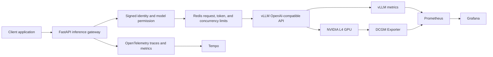

# AI Infrastructure Handbook

This handbook explains the ideas behind the single-L4 inference lab in plain
language. It is an educational reference, not proof that the proposed AWS system is
running. As of this revision, the repository has prepared source code and local CPU
validation, but no NVIDIA L4 instance has been provisioned and no GPU inference or
GPU benchmark has run. Read [Implementation Status](IMPLEMENTATION_STATUS.md) and
the [execution journal](EXECUTION_JOURNAL.md) for current evidence.

## 1. The platform in one picture



The diagram describes the intended request path. The gateway authenticates the
caller and makes tenant policy decisions. Redis keeps admission counters shared
between gateway replicas. vLLM runs the language model and schedules work on the L4.
Prometheus collects numeric time series, Grafana presents them, and OpenTelemetry
connects application operations into traces. All services are planned for one EC2
host in this lab. That is useful for hands-on learning, but it is one failure domain.

The repository also has a CPU ONNX inference path and an EKS deployment contract.
The GPU lab is a separate EC2 profile. The CPU path is valuable because developers
can test routing, authentication, quotas, and failure handling without renting a GPU.

## 2. GPU hardware and its software layers

### CPU and GPU

A CPU has a small number of complex cores designed to handle varied tasks and react
quickly to one thread of work. A GPU has many simpler execution lanes designed to
apply similar operations to many values at once. A CPU is like a few expert workers
who can switch jobs quickly; a GPU is like a large team doing the same kind of work
in parallel.

Language models repeatedly multiply large matrices. The same operation applies to
many rows, columns, and tokens, so a GPU can perform that work efficiently. A GPU is
not automatically faster for every program. Small jobs may be dominated by the cost
of starting a kernel or moving input across PCI Express (PCIe), the high-speed link
between the host and accelerator.

### NVIDIA L4 and VRAM

The target is one NVIDIA L4 in an AWS `g6.xlarge` instance. It is a virtual machine
with one attached L4 accelerator, not a physical server that the operator owns. Its
graphics memory, called video random access memory (VRAM), stores model weights,
attention state, temporary tensors, and runtime workspaces. The application sees one
shared GPU. Two tenants making requests do not receive separate memory partitions.

The `g6.xlarge` shape is the preferred first experiment; it has 4 virtual CPUs and
16 GiB of system memory in the current design record. A larger `g6.2xlarge` would
still have one L4 and is considered only if measured host CPU or RAM needs justify
it. Do not infer a machine's available model capacity from the instance name alone:
inspect GPU memory, host memory, actual model precision, context length, and runtime
overhead on the machine.

### CUDA, drivers, and containers

CUDA is NVIDIA's platform for programming general-purpose GPU computation. Several
pieces have similar names but distinct jobs:

| Part | Job | Example check |
| --- | --- | --- |
| Physical accelerator | Performs arithmetic and owns VRAM | EC2 instance documentation; `lspci` inside the guest |
| NVIDIA kernel driver | Lets Linux manage and communicate with the device | `nvidia-smi`, `lsmod`, kernel logs |
| CUDA driver API | Exposes driver operations to user programs | Used by CUDA libraries and runtimes |
| CUDA runtime libraries | Provide common functions that applications call | Container library inspection; PyTorch runtime check |
| CUDA Toolkit | Development tools and headers, including `nvcc` | `nvcc --version` |
| NVIDIA Container Toolkit | Connects host GPU devices and driver libraries to containers | `nvidia-ctk`, then a GPU-enabled container |
| Docker GPU request | Tells Docker to expose the selected device to the container | `docker run --gpus all ... nvidia-smi` |

`nvidia-smi` reports the maximum CUDA driver compatibility level advertised by the
installed NVIDIA driver. It does not prove that the CUDA Toolkit compiler is
installed, and it does not report the exact CUDA libraries loaded by a particular
container. `nvcc --version` reports the installed compiler/toolkit. A container may
bring its own compatible CUDA user-space libraries while using the host kernel
driver. This is why the vLLM container can serve requests without the host compiler,
while the CUDA C++ learning exercises need the host Toolkit.

The driver must support the user-space CUDA version required by the container. If
the driver is too old, a program can fail with a driver/runtime incompatibility. If
the host device is not passed through, container libraries cannot create a GPU that
the host does not expose. Troubleshoot from the outside inward: verify `nvidia-smi`
on the host, inspect Docker's configured runtime, then run a minimal CUDA container
before debugging PyTorch or vLLM.

## 3. GPU parallel programming

### Threads, warps, blocks, and grids

A CUDA kernel is a function executed by many GPU threads. Threads are grouped into
blocks; blocks form a grid. Threads in a block can cooperate through fast shared
memory and barriers. The GPU schedules groups of 32 threads called warps on its
streaming multiprocessors (SMs). An SM is a collection of execution units and local
resources that runs groups of threads.

If a vector has one million items, a vector-add kernel can assign each thread an
index and add one pair of numbers. The number of blocks is selected so all elements
are covered, while each thread checks that its index is below the vector length.
This simple exercise teaches launch geometry and memory access before the more
complex matrix operations used by neural networks.

CUDA launches are often asynchronous. The CPU can enqueue work and continue before
the GPU finishes. Timing only the CPU call can therefore measure the enqueue time,
not the computation. Correct measurements warm up the GPU, synchronize before and
after the timed operation, repeat enough times, and report a distribution or stable
summary. Host-to-device transfer, kernel execution, and device-to-host transfer
should be measured separately as well as together.

### Memory and performance limits

GPU registers are the fastest storage and belong to individual threads. Shared
memory is a small, fast area shared by threads in a block. Global memory is the
large VRAM area visible to kernels, but has higher access latency. Kernel programs
that reuse nearby data can make better use of the hardware. Poor access patterns
can spend more time waiting for memory than doing arithmetic.

A workload is **compute-bound** when arithmetic throughput is the main limit. It is
**memory-bound** when data movement or memory bandwidth is the main limit. It can
also be limited by CPU preparation, kernel launch overhead, batch formation, or
PCIe transfers. GPU utilization alone does not identify the cause: a GPU can appear
busy while delivering low useful throughput, or appear lightly used because the
input pipeline cannot feed it quickly enough.

The lab compares CPU and GPU vector addition and matrix multiplication, varies
matrix size and precision, records warm-up and repeats, and uses profiler tools when
available. FP32, FP16, and BF16 are numeric formats. FP32 stores more precision but
uses more memory than 16-bit formats. FP16 and BF16 can use tensor cores for fast
matrix operations, though their numerical range and rounding differ. The result
must be checked for correctness as well as speed. This project must record actual
measurements; planned charts are not benchmark evidence.

## 4. Language models and inference

### Tokens, embeddings, and weights

A language model does not read words directly. A tokenizer splits text into tokens
and maps them to integer IDs. A token may be a word, part of a word, whitespace, or
punctuation. The model maps token IDs to embedding vectors, which are learned
numeric representations used in later calculations.

Model parameters are the learned numbers in the model. A checkpoint stores those
numbers as weights, along with configuration and tokenizer files. Parameter count
is one rough size indicator, not the full serving memory requirement. Inference
also needs temporary buffers, attention state, framework allocations, and often a
copy of each request's prior attention information.

A neural network is a set of connected numeric operations whose parameters are
adjusted using examples. During **training**, the system compares predictions with
target answers, calculates how the parameters contributed to the error, and updates
the parameters repeatedly. Training usually needs gradients, optimizer state, and
large datasets, so its memory and compute needs differ from serving. During
**inference**, the model uses fixed weights to produce an answer; it does not update
those weights. This project serves a prepared model and does not train or fine-tune
it. **Fine-tuning** continues training from an existing model on a narrower dataset
to adapt its behavior; it would require a separate dataset, quality/safety review,
and compute plan. It is outside the single-L4 lab objective.

### Transformer attention and the KV cache

Transformers process token representations through layers. In self-attention, each
token generates query, key, and value vectors. A query is compared with keys to
measure which prior tokens matter; the resulting weights combine value vectors into
contextual information. This lets the model use earlier prompt tokens when
calculating later tokens.

When generating one token at a time, the model could recalculate the keys and values
for the entire existing sequence on every step. That repeats work. The key/value
(KV) cache retains those vectors so the next token can reuse them. It speeds up
decoding, but consumes VRAM for every cached layer, token, and active sequence.
Longer context and more concurrent requests therefore require more cache memory.

For an ordinary multi-head model, a rough cache estimate is:

```text
cache bytes ≈ layers × 2 (key and value) × KV heads × head size
              × bytes per value × cached tokens × active sequences
```

This estimate excludes padding, allocator fragmentation, runtime workspaces, and
temporary activations. A project note derives about 28 KiB per token for the pinned
Qwen 1.5B configuration, or roughly 224 MiB for one 8,192-token sequence in BF16.
That is a configuration-based estimate, not measured L4 use. Read
[Research Notes](RESEARCH_NOTES.md) for the assumptions and the warning about the
model's differing tokenizer and model context metadata.

### Prefill, decode, and serving

Inference has two important stages. **Prefill** processes the initial prompt and
populates attention state. It can involve large parallel matrix operations. **Decode**
generates one new token at a time, reusing cached values. Decode latency and cache
capacity can become visible when many sequences are active.

The lifecycle is:

1. The gateway authenticates the signed tenant identity and checks model permission.
2. Admission control reserves capacity under that tenant's request and token limits.
3. The tokenizer converts prompt text to token IDs.
4. vLLM batches compatible work and runs prefill on the GPU.
5. vLLM caches attention keys and values for the active sequence.
6. Decode calculates next-token scores, then a sampling rule selects a token.
7. vLLM streams token pieces to the gateway; the gateway streams them to the client.
8. The gateway settles measured token use and releases concurrency exactly once.

vLLM is a model-serving runtime. It provides an OpenAI-compatible API and schedules
multiple requests on shared GPU resources. Continuous batching allows the runtime to
add and remove sequences as they progress instead of waiting for one fixed batch to
finish. PagedAttention organizes KV-cache blocks so variable-length sequences can
share GPU memory more efficiently and reduce waste. Neither technique creates
hardware isolation between tenants.

Temperature changes how sharply token probabilities are sampled. Lower temperature
usually makes selection more deterministic; higher temperature allows more varied
outputs. Top-p sampling keeps a set of likely candidates whose cumulative probability
reaches a chosen threshold. Sampling affects output behavior, not authorization or
quota. A model's context limit is the total supported prompt and generated sequence
length, subject to the exact model configuration and runtime.

Quantization stores weights at lower numeric precision or with fewer bits. This can
reduce weight memory and increase feasible capacity, but may affect quality and may
not accelerate every model/hardware combination. Evaluate the actual artifact and
kernel support instead of assuming that a quantized model is always faster. The
initial project target is the pinned Qwen 1.5B revision; larger or quantized models
are future experiments gated on measured memory headroom and the $25 budget.

## 5. Inference performance and capacity

Different metrics answer different questions:

| Measure | Meaning | What can make it worse |
| --- | --- | --- |
| Time to first token (TTFT) | Time from request start until first output token | Tokenization, long prefill, queueing, cold model load |
| Time per output token (TPOT) | Average time spent generating each output token after the first | Decode throughput, contention, memory bandwidth |
| Inter-token latency (ITL) | Delay between consecutive output tokens | Decode scheduling and resource contention |
| End-to-end latency | Total request duration | Queueing plus all processing and output transfer |
| Throughput | Tokens or requests completed per unit time | Model, precision, batch shape, CPU/GPU saturation |
| Queue duration | Time waiting before execution | Arrival rate exceeding available service capacity |

P50 is the median: half of observed values are lower and half are higher. P95 and
P99 show the slower tail of the measurements. Tail latency often grows before the
average looks alarming because a small share of requests waits longer in queues or
hits expensive prompt lengths.

Concurrency is the number of requests executing or waiting at once. Increasing it
may improve throughput by keeping the GPU busy, but can also increase queue delay,
memory use, and tail latency. Batch size is the amount of work grouped for a shared
GPU operation; large batches use the GPU efficiently but may make each client wait
longer. The correct operating point depends on the workload and tenant objectives.

A benchmark should define input and output lengths, concurrency, arrival pattern,
warm-up, repetition count, model revision, image digest, software versions, and
runtime limit. It should record raw tool output and GPU telemetry. Change one major
factor at a time where possible. Report observed values and sample sizes; do not
label a small laboratory run as a production service-level objective (SLO).

The benchmark matrix planned here uses vLLM's serving benchmark plus a gateway
benchmark. The gateway adds authentication, Redis admission, routing, stream
handling, and accounting overhead, so direct-runtime and gateway measurements are
both useful. They must use comparable prompts and the same model. The benchmark
tools have local dry-run validation, but no L4 measurement has yet been captured.

## 6. Multi-tenant controls and distributed state

### Identity and authorization

An Ed25519-signed identity is a token whose signature can be verified with a public
key. The gateway checks issuer, audience, expiry, signature, and server-side policy.
The tenant ID comes from that verified identity. A client-supplied tenant header is
untrusted and must not override it. Authentication answers “who is making this
request?” Authorization answers “may this identity call this model or operation?”

Logical tenant isolation means the application enforces separate identity, model
permission, quotas, and audit labels. It does not mean the GPU has separate memory
or execution partitions. All tenants share one L4 and a host administrator can
inspect the host. Hardware isolation needs separate machines or supported hardware
partitioning; this L4 lab does not implement that.

### Redis, quotas, and admission control

Redis is an in-memory data store used here as shared coordination state. Two gateway
replicas cannot safely maintain independent quota counters: each would believe it
has unused capacity. Shared Redis lets both replicas participate in one logical
counter system. An atomic Lua operation can check and reserve request count, token
budget, and active concurrency together so two near-simultaneous requests cannot
both spend the same remaining capacity.

Admission control decides whether a request may start. A bounded queue holds a
limited number of accepted requests when capacity is briefly busy. Backpressure
rejects or delays new work when the queue is full instead of allowing unbounded
memory growth and ever-longer waits. A timeout limits how long a request or queue
reservation may remain active. Cancellation should stop downstream generation when
the client disconnects and release the reservation.

Quota accounting needs request IDs and idempotent transitions. If retrying a cleanup
would decrement concurrency twice, the system can accidentally allow too much work.
If it never releases a failed request, it can block healthy tenants. Store a bounded
lease or an equivalent recovery record so abandoned reservations can expire. Token
limits are initially reserved before execution; then measured prompt/completion
usage should reconcile the reservation once. If actual usage cannot be known after a
crash, document a conservative rule rather than silently treating it as zero.

When Redis is unavailable, this platform should fail closed: it cannot prove that a
tenant is under quota, so it should reject requests instead of letting all traffic
through. This reduces availability during a Redis outage but protects shared GPU
capacity and tenant policy. Test the failure path rather than relying on a dashboard
or a configuration statement.

Two gateway containers on one EC2 host are process redundancy, not high availability.
They share the host, network, GPU, Docker daemon, and often the same Redis service.
A host reboot or lost instance stops all of them.

## 7. Evaluation, release, and rollback

Model evaluation checks whether a candidate behaves well on a known dataset. A
synthetic test set can contain exact-answer tasks, structured JSON tasks,
instruction-following examples, summaries, and invalid inputs. Deterministic tests
are preferable where there is an objective rule, such as required JSON keys or a
fixed expected label. Subjective quality should be clearly marked as subjective and
use a documented rubric; a language-model judge can vary and should not be treated
as a ground-truth oracle.

A model registry is a catalog of model versions and their provenance, evaluation,
and release status. MLflow can record runs, metrics, and model artifacts. In this
repository, the prepared release workflow links a candidate to evaluation metadata
and a proposed immutable plan. That local control path is not yet proof that the
registry has held a real LLM artifact or that a candidate was served on an L4.

An immutable release plan records the candidate revision, artifact digest, runtime
image, evaluation report, and intended transition. Independent approval reduces the
risk that the same person both proposes and authorizes a protected change. A
single-GPU release should normally stop the current model, load the candidate, check
readiness, and either accept it or reload the known-good revision. Running both
models at once may exceed VRAM; no zero-downtime claim should be made without
measuring that exact configuration.

The repository has release planning and host-side controller code prepared for
future testing. A local CPU test does not prove LLM quality, live GPU readiness, or
successful model rollback. Those acceptance criteria require real L4 execution.

## 8. Metrics, traces, and safe observability

Prometheus stores numeric samples over time. A time series is identified by a metric
name and labels. Labels should be low-cardinality: values should come from a small,
bounded set. A unique request ID, raw prompt, user ID, or arbitrary tenant text on
every metric creates unbounded series and can exhaust Prometheus memory. Put
request-specific context into sampled traces or sanitized logs instead, and keep
prompt and completion content out of both.

DCGM Exporter exposes NVIDIA Data Center GPU Manager (DCGM) device metrics such as
utilization, memory, power, clocks, and temperature where the GPU and driver expose
them. Node Exporter reports Linux host metrics. vLLM exposes runtime counters and
latency histograms. The gateway reports authenticated request, admission, and
tenant-usage metadata. Redis metrics help reveal command load and health. These
sources answer different questions; correlate them by time and trace context.

OpenTelemetry defines APIs and formats for traces, metrics, and logs. A trace is a
set of related spans such as gateway auth, Redis reservation, and downstream model
call. Context propagation uses trace identifiers so services can connect their
spans. Whether the selected vLLM release propagates compatible trace context must
be tested. Tempo stores traces; Grafana can show traces beside Prometheus charts.

An alert should identify a user impact or a likely failure with a clear action. For
example, a sustained readiness failure or GPU memory pressure may justify an alert;
a momentary utilization spike may not. Establish thresholds from measured lab
baselines, and label them as laboratory thresholds. Do not invent production SLOs
from one short experiment. Alert delivery itself must be tested, and alert emails
must never reveal prompts, outputs, secrets, or private endpoints.

## 9. Reliability and operational failure modes

| Symptom | Possible cause | First checks |
| --- | --- | --- |
| Host cannot see GPU | Wrong instance type, driver not installed, module failed | EC2 type, `lspci`, `lsmod`, `nvidia-smi`, kernel journal |
| Host sees GPU, container does not | NVIDIA Container Toolkit or Docker runtime configuration | `docker info`, `nvidia-ctk`, minimal CUDA container |
| CUDA “out of memory” | Weights, KV cache, workspaces, context or concurrency too large | `nvidia-smi`, vLLM memory metrics, active sequence lengths |
| Low GPU utilization | CPU/tokenizer bottleneck, low arrival rate, small work, queue behavior | CPU, request rate, batch metrics, traces, profiler |
| High TTFT | Queue wait, cold model start, long prompt prefill | Queue duration, model readiness, input tokens, traces |
| Quota rejection for healthy tenant | Incorrect shared counter, stuck reservation, actual usage reconciliation | Redis keys through safe tooling, request lifecycle events |
| Requests pass during Redis outage | Fail-open admission path | Controlled outage test, gateway logs and status codes |
| Metrics missing | Exporter down, wrong target, bad label/configuration | Prometheus target health, container logs, exporter endpoint |

Symptoms are observations; root cause is the underlying reason. For example, high
TTFT is a symptom. A long queue caused by a stuck concurrency reservation may be a
root cause. A driver reset in host logs might instead explain the same symptom by
making GPU work stall. Compare timelines and test alternatives before choosing a
fix.

Use bounded timeouts, capped queues, health checks, and explicit recovery actions.
Retries can multiply load during an outage, so retry only transient errors, cap
attempts, use backoff, and ensure requests are idempotent where possible. A
circuit breaker temporarily stops calls to a failing dependency so the gateway does
not build an endless backlog. The initial lab should favor visible errors and safe
rejection over silent, unbounded work.

## 10. Cost, security, and cloud boundary

AI FinOps connects model quality and request volume to the full cost of serving.
Cost per request can be approximated as:

```text
cost per successful request = total attributable infrastructure cost
                              ÷ successful requests
```

Cost per million input tokens is:

```text
total attributable cost ÷ measured input tokens × 1,000,000
```

Use output tokens separately because generation may consume different runtime time
from prompt processing. Report the allocation rule, time window, and included
resources. The instance hourly rate is not the full cost: include attached storage,
public IPv4 if present, network transfer, remote state and locking, monitoring
storage, taxes, and actual billed charges when available. AWS Budget notifications
are alerts and can be delayed; they are not a hard cap. The project ceiling is $25
total, so use short batches and terminate the instance promptly.

IAM should grant the EC2 role only the access needed for Systems Manager and the
specific project operations. IMDSv2 should be required. Keep inference, Redis,
Grafana, and Prometheus private to the host network or Session Manager tunnel. Do
not put API tokens in images, public Git, shell arguments, dashboard labels, or
logs. Avoid public inbound service ports. A public subnet with no inbound rule still
has outbound internet access and a public address may expose the host to scans.

The account quota number only states the maximum instance capacity AWS may allow;
it does not reserve capacity, authorize spending, or prove that a particular AZ can
launch now. Before an apply, recheck account, applied quota, price, capacity, exact
resource plan, expiry timer, and teardown. The owner authorizes the exact paid plan.
The PR workflow and static CI must never launch GPU resources automatically.

## 11. Distributed GPU concepts for later study

These terms matter in larger systems but are not implemented by this single-L4 lab:

- **NCCL** is NVIDIA's library for GPU collective communication, such as exchanging
  tensors among GPUs. It is commonly used by distributed training and inference.
- **Tensor parallelism** splits pieces of layer matrix operations across multiple
  GPUs. GPUs must exchange intermediate results, so fast interconnects matter.
- **Pipeline parallelism** assigns different groups of model layers to different
  GPUs and moves activations between them. It can fit larger models but introduces
  pipeline scheduling and communication challenges.
- **Multi-node training** coordinates computation across machines. It needs data
  partitioning, collective communication, fault recovery, checkpoints, and careful
  network engineering.
- **GPU scheduling** places accelerator workloads onto hosts with enough device
  memory and compatible drivers. A scheduler must account for device availability,
  resource fragmentation, and failures.
- **Kubernetes GPU orchestration** typically uses device plugins and node labels to
  expose accelerators to pods. It adds cluster lifecycle, scheduling, networking,
  operators, and node maintenance. This project's EKS contract is not being deployed.

Two gateway replicas do not constitute distributed inference. This project uses one
L4, one host, and one sequentially loaded model. It does not test NCCL, tensor or
pipeline parallelism, multi-node training, MIG, or Kubernetes GPU scheduling.

## 12. Practical verification sequence

When an authorized L4 batch is eventually available, check each layer before moving
upward:

1. `lspci` and the EC2 instance metadata establish that the VM exposes the expected
   accelerator.
2. `nvidia-smi` and `nvidia-smi -L` establish that the driver can query the L4.
3. `nvcc --version` checks the host compiler only; it is not required by every
   container workload.
4. A small GPU container checks device exposure through Docker.
5. PyTorch allocates a tensor, multiplies matrices, synchronizes, and checks results.
6. A real vLLM readiness check and OpenAI-compatible request prove model serving.
7. A signed tenant request through both gateways proves the end-to-end application
   path and shared Redis admission behavior.
8. Prometheus, Grafana, and traces show whether the workload is visible and how
   resources behaved.
9. Export sanitized results, execute the reviewed teardown, and independently
   verify that project resources are absent.

The manual commands and expected output are in the
[Manual Reproduction Guide](MANUAL_REPRODUCTION_GUIDE.md); current blockers and
per-phase evidence are in [Implementation Status](IMPLEMENTATION_STATUS.md). Treat
every item above as a planned checkpoint until the journal records real output.
