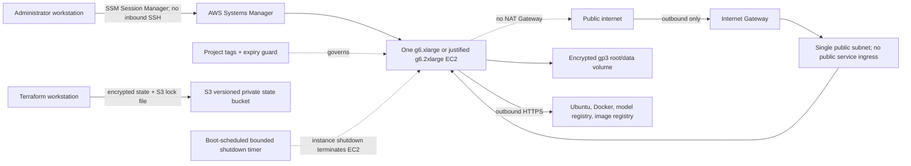
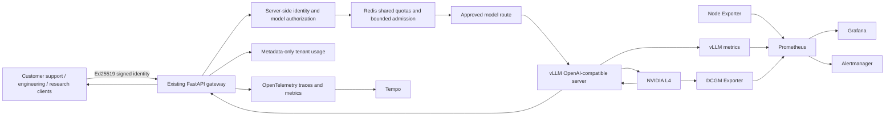
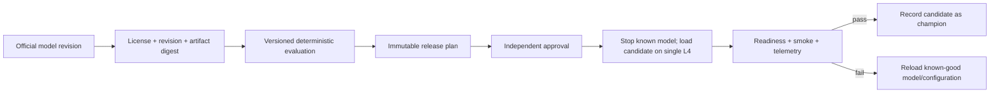

# Single-L4 GPU Lab Architecture

**Status: PROPOSED.** These diagrams describe the intended isolated EC2 profile, not a deployment. Replace or qualify them when implementation and execution evidence establish what actually runs.

## Proposed AWS topology

The state bucket and boot expiry are proposed controls, not deployed resources. The
preferred state-lock design is Terraform's S3-native lock file rather than a
DynamoDB table. A timer on the EC2 guest is a second independent runtime limit; it
must schedule a machine shutdown while EC2 is configured to terminate after a
guest-initiated shutdown. Before any paid apply, test the actual startup path and the
timer expiry behavior. The instance must also delete its encrypted gp3 volume on
termination. Session Manager access uses an instance role and outbound HTTPS; it
does not need an inbound SSH rule. The public subnet still has an egress path, so
limit it to the test window and document that the instance has a public address even
when no inbound service port is open.

## Proposed host and request path

This is a one-host lab. The gateway, Redis, inference server, and monitoring services may share the same EC2 host if the measured RAM, CPU, disk, and GPU capacity support it. Two processes or containers on one host do not provide infrastructure high availability. Redis admission is logical tenant policy, not physical GPU isolation. The host uses one L4; no GPU partitioning, multi-node execution, Kubernetes, or managed database/cache is part of this design.

## Proposed model lifecycle

Sequential deployment and recovery are the default because one GPU may not have room for two loaded models. A zero-downtime or concurrent canary claim requires separate measured memory and execution evidence.

## Provisioning and teardown

```mermaid
flowchart LR
  Preflight[Verify account, region, quotas, pricing, tags, existing resources] --> Source[Terraform isolated root]
  Source --> Plan[Format, validate, exact saved plan review]
  Plan --> Approval[Confirm exact resources, runtime and total <= $25]
  Approval --> Apply[Apply through recorded run monitor]
  Apply --> Configure[Manual setup, then Ansible]
  Configure --> Deploy[Compose, inference, tests, benchmarks]
  Deploy --> Export[Sanitize and export evidence]
  Export --> Destroy[Terraform destroy of this root only]
  Destroy --> Check[Provider-side absence checks]
```

No mutation is allowed before a documented price/quota/capacity and resource-lifetime plan fits the initial ceiling. Budget alerts alone are not a spending cap. This profile must use an independent expiry/cleanup safeguard and terminate compute between execution batches.

## Existing CPU architecture retained

The existing, executed local CPU system is mapped in [the flagship system map](../architecture/flagship-system-map.md). The new EC2 path is separate from the planned EKS Terraform and Kubernetes contract. Later diagrams must distinguish these paths and cite evidence for every component marked as executed.
