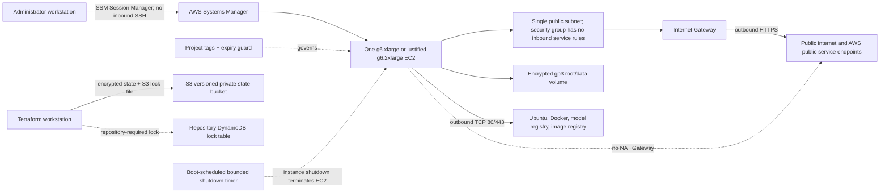
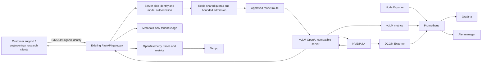
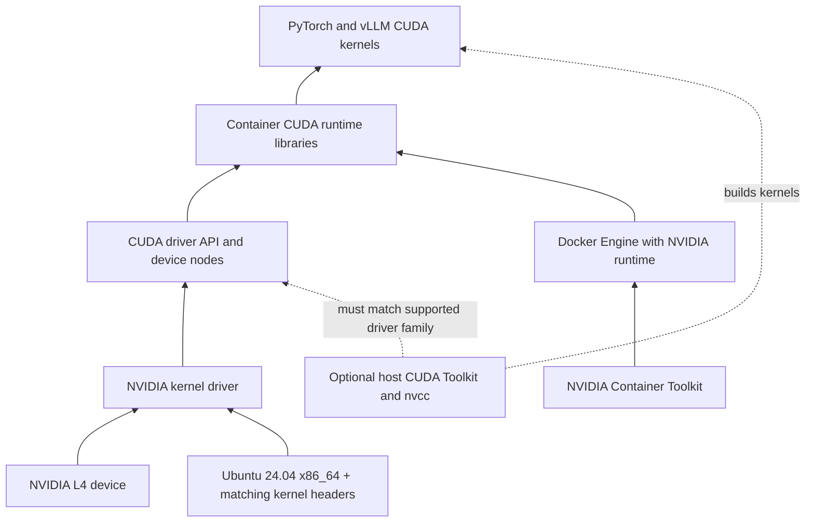
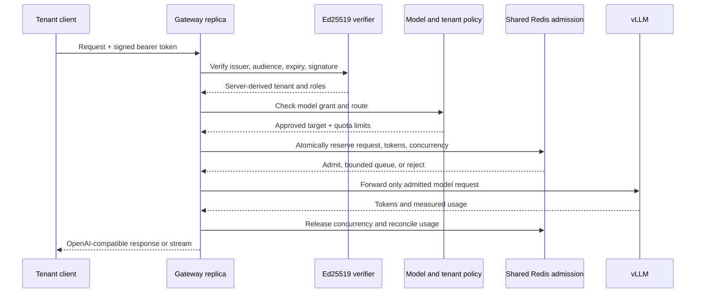
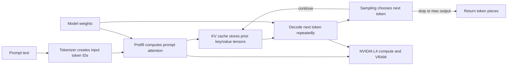
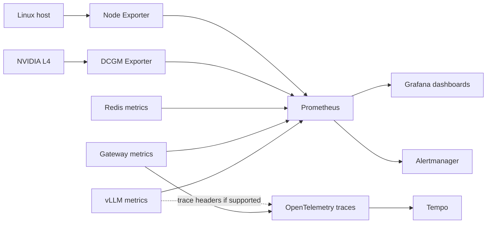
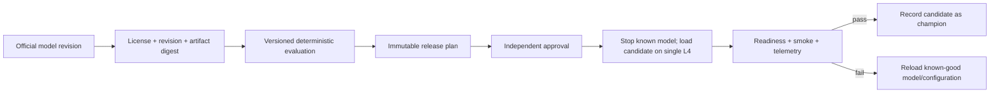

# Single-L4 GPU Lab Architecture

**Status: PROPOSED.** These diagrams describe the intended isolated EC2 profile, not a deployment. Replace or qualify them when implementation and execution evidence establish what actually runs.

## Proposed AWS topology

The state bucket, lock table, and expiry are proposed controls, not deployed
resources. Reuse the repository's private, versioned state bucket and repository-
scoped DynamoDB lock table from its existing bootstrap contract. Assign the GPU root a
unique `gpu-ec2/` state-key namespace, and use Terraform's S3 lock file too. HashiCorp
marks DynamoDB locking deprecated but documents support for both locks during
migration; configure and test this with the selected Terraform release. The guest
timer is a second independent runtime limit; it must shut down the machine while EC2
terminates after a guest-initiated shutdown. Before any paid apply, test the actual
startup path and expiry behavior. The instance must also delete its encrypted gp3
volume on termination.
Session Manager access uses an instance role and outbound TCP 443; it does not need
an inbound SSH rule. Package mirrors may also need outbound TCP 80. The public subnet
still has an egress path, so limit it to the test window and document that the
instance has a public address even when no inbound service port is open.

## Proposed host and request path

This is a one-host lab. The gateway, Redis, inference server, and monitoring services may share the same EC2 host if the measured RAM, CPU, disk, and GPU capacity support it. Two processes or containers on one host do not provide infrastructure high availability. Redis admission is logical tenant policy, not physical GPU isolation. The host uses one L4; no GPU partitioning, multi-node execution, Kubernetes, or managed database/cache is part of this design.

## Proposed Linux and GPU software stack

This drawing separates the host driver from CUDA user-space libraries. The final
vLLM container supplies its own CUDA runtime and PyTorch dependencies; the host CUDA
Toolkit is mainly needed for compiling CUDA C++ experiments. The driver must still
support the container's CUDA runtime.

The repository now pins researched candidates so a future run can be reproduced:

| Layer | Pinned candidate | What is established |
| --- | --- | --- |
| Host OS | Ubuntu 24.04 x86-64 Canonical AMI | AMI identity and static preflight checks are prepared; kernel behavior on an L4 is untested. |
| NVIDIA driver | `580.196.11-1ubuntu1` | Package version and signing inputs were checked in official indexes on 2026-11-27; installation and reboot are untested. |
| Host CUDA Toolkit | `13.0.3-1` | Candidate package is pinned for CUDA C++ exercises; no host compiler or kernel has run. |
| NVIDIA Container Toolkit | `1.20.2-1` | Candidate package is pinned; Docker GPU device access is untested. |
| Docker | Engine `5:29.9.3-1~ubuntu.24.04~noble`; Compose `5.8.0-1~ubuntu.24.04~noble` | Candidate package versions are pinned; host installation is untested. |
| Standalone CUDA PyTorch lab | PyTorch `2.14.0+cu130`, CPython 3.12, Linux x86-64 | Hash-locked separately for CUDA experiments; it is not layered into the vLLM image. No GPU tensor operation has run. |
| Model server | vLLM OpenAI image `v0.34.0`, pinned to AMD64 image digest `sha256:cf5b2fdd087eb4f6d261736967cc5cde974bd22ff4df50365f8fa419b6b4c484` | Registry metadata and release compatibility notes were researched; image load and inference on an L4 are untested. |
| Initial model | `Qwen/Qwen2.5-1.5B-Instruct` revision `989aa7980e4cf806f80c7fef2b1adb7bc71aa306` | Hub metadata reports Apache-2.0 and a pinned weight digest; weights have not been downloaded or loaded. |

These are dated, pinned candidates, not an already proven compatible stack. Refresh
package availability, signatures, image digest, model license and digest, current
driver/runtime support, and price immediately before an authorized batch. The live
L4 run must validate this exact combination or capture a reasoned version change in
the journal and update the locks before proceeding. See
[`RESEARCH_NOTES.md`](RESEARCH_NOTES.md), the [host install manifest](GPU_HOST_INSTALL_MANIFEST.md),
and the [GPU batch runbook](GPU_BATCH_RUNBOOK.md) for sources and steps.

## Proposed identity, authorization, and tenant quotas

Tenant headers remain untrusted input: only the verified signed identity supplies
the tenant. Redis is shared across gateway replicas so each replica sees the same
admission state. A Redis error must fail closed. These are application-level limits;
all tenants still share one physical GPU.

The existing Redis code is a baseline, not this final lifecycle. Its current release
does not reconcile actual tokens, and its active request count is not a per-request
lease. The GPU adapter must not make usage or crash-recovery claims until it can reserve
by request ID, settle or release that reservation idempotently, and recover abandoned
concurrency reservations after a bounded lease.

## Proposed request reservation lifecycle

```mermaid
stateDiagram-v2
  [*] --> Authenticated
  Authenticated --> Rejected: invalid identity or model grant
  Authenticated --> Reserved: atomic Redis reservation
  Authenticated --> Rejected: quota full or Redis unavailable
  Reserved --> Running: request reaches vLLM
  Running --> Settled: final measured usage reconciled once
  Running --> Cancelled: client or server cancels
  Cancelled --> Settled: partial usage measured/reconciled
  Running --> Failed: backend failure or timeout
  Failed --> Settled: known usage reconciled; otherwise bounded reservation policy
  Reserved --> Expired: worker dies before start
  Running --> Expired: lease expires after worker crash
  Settled --> [*]
  Rejected --> [*]
  Expired --> [*]
```

Every transition must be safe to repeat, so a retry or cleanup path cannot decrement
concurrency twice or count the same token usage twice. Unknown usage after a process
crash needs an explicit conservative accounting policy. The detailed design and tests
belong to the gateway integration package; this diagram is proposed only.

## Proposed LLM request execution on the L4

The KV cache is per-running sequence state on the GPU. It avoids recomputing
attention projections for earlier input/output tokens, which can lower decode work,
but consumes more VRAM as context length and concurrent sequences grow. This is why
model weights alone do not determine whether a request fits on the L4.

## Proposed GPU observability flow

This diagram is proposed. The actual metric names, labels, exporter versions, and
vLLM trace propagation must be discovered and verified against the selected images;
never assume dashboard expressions are live data. Prompt and completion text must
not be labels or trace attributes.

## Why one EC2 host instead of Kubernetes

The learning objective is one full L4 and one disposable inference host. A standalone
EC2 instance exposes the operating-system driver setup, container GPU wiring, and
single-GPU resource limits directly. Docker Compose already exists in the repository
and can run one host's services without adding a scheduler. An EKS cluster would add
a control plane, cluster networking, GPU scheduling/operator setup, and node lifecycle
that do not help validate one accelerator. The repository's EKS contract remains
available for a separate future project. This EC2 lab has a single host failure
domain, no high availability, and no physical tenant isolation.

## Proposed model lifecycle

Sequential deployment and recovery are the default because one GPU may not have room for two loaded models. A zero-downtime or concurrent canary claim requires separate measured memory and execution evidence.

## Provisioning and teardown

```mermaid
flowchart LR
  Preflight[Verify account, region, quotas, pricing, tags, existing resources] --> Source[Terraform isolated root]
  Source --> Plan[Format, validate, exact saved plan review]
  Plan --> Approval[Confirm exact resources, runtime and total <= $25]
  Approval --> Apply[Apply through recorded run monitor]
  Apply --> Configure[Manual setup, then Ansible]
  Configure --> Deploy[Compose, inference, tests, benchmarks]
  Deploy --> Export[Sanitize and export evidence]
  Export --> Destroy[Terraform destroy of this root only]
  Destroy --> Check[Provider-side absence checks]
```

No mutation is allowed before a documented price/quota/capacity and resource-lifetime plan fits the initial ceiling. Budget alerts alone are not a spending cap. This profile must use an independent expiry/cleanup safeguard and terminate compute between execution batches.

## Existing CPU architecture retained

The existing, executed local CPU system is mapped in [the flagship system map](../architecture/flagship-system-map.md). The new EC2 path is separate from the planned EKS Terraform and Kubernetes contract. Later diagrams must distinguish these paths and cite evidence for every component marked as executed.
