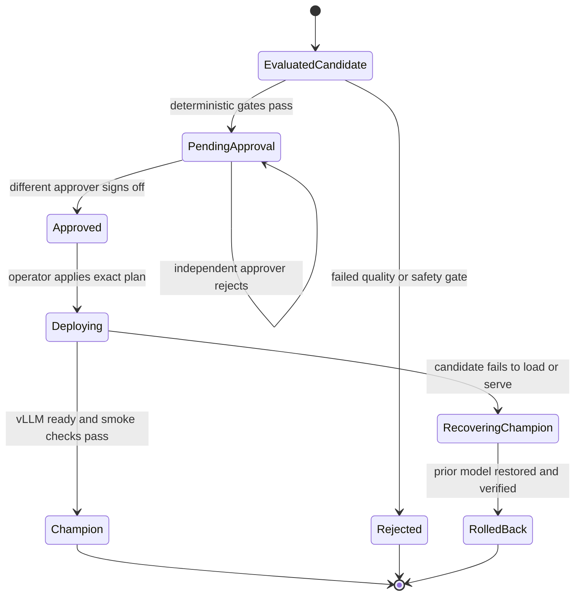

# Single-GPU LLM Release Design

**Status:** proposed design; no LLM release has been registered or deployed through
the GPU profile. **Reviewed:** 2026-11-27.

## Why the current release flow cannot deploy the GPU model

The existing release API and database support the local ONNX classifier. The API
hardcodes that model name, its `champion` and `candidate` aliases, and two ONNX target
names. It publishes canary weights to Redis. The dedicated GPU profile instead has
one vLLM endpoint and one served-model alias. Giving two names different weights when
both names point to the same vLLM process would not create a real canary; loading two
large models concurrently would also violate the one-L4 capacity constraint.

The GPU Compose profile currently has no MLflow service. The default local Compose
does include MLflow, but it is not reachable from EC2. The static LLM evaluator writes
a sanitized report outside Git; it does not send the report to MLflow. Therefore the
current GPU profile does not yet satisfy model registry, governed release, or rollback
acceptance criteria.

Keep the existing ONNX flow unchanged. Add a separate LLM release path that records
model artifacts and uses a sequential vLLM restart on the single L4.

## Proposed release record

Store a small deployment manifest in MLflow for each model version. The model weights
remain in the approved Hugging Face source; the manifest records their immutable
identity and verification data rather than copying multi-gigabyte weights into the
MLflow artifact store.

The manifest should include:

- model repository and immutable revision;
- model license and artifact digest;
- vLLM image digest and runtime configuration;
- evaluation suite digest, sanitized report digest, deterministic gate, and human
  review outcome;
- source commit and creation time;
- the deployment alias (`champion` or `candidate`).

Never store prompts, completions, bearer tokens, or private model files in the report
or public Git. Keep only the sanitized evaluation evidence and artifact provenance in
the registry.

## Proposed state machine

An immutable plan must bind the current champion manifest digest, candidate manifest
digest, model image digest, complete vLLM configuration, evaluation report digest,
approval identity, and target environment. Reject a stale plan if the current
champion, candidate, runtime image, or configuration changes after approval.

## Sequential deployment on one L4

The operator applies the approved plan through the EC2 host's private control path:

1. Verify the plan digest, approval identity, current champion, runtime image, free
   disk, and expiry/cost reserve.
2. Preserve the currently deployed manifest and Compose environment as the rollback
   target. Do not remove the model cache or old manifest.
3. Stop the one vLLM server and start it with the candidate model revision and
   approved configuration. This causes a service interruption while the model
   reloads; it is not zero-downtime deployment.
4. Wait for vLLM readiness, confirm the served model identity, and run a small
   non-sensitive smoke request through the gateway.
5. If checks pass, record the deployment and move the MLflow `champion` alias to the
   candidate. Retain the prior manifest so a later rollback can restore it.
6. If load, readiness, or smoke checks fail, restore the prior configuration, restart
   vLLM, and verify the old champion before marking the plan rolled back. Keep the
   candidate failure logs and do not mark it successful.

The two gateway replicas remain on the same EC2 instance and share one vLLM server.
They provide application-level concurrency, not infrastructure high availability.
No traffic-weighted canary or simultaneous model load is claimed.

## MLflow placement and storage

The first lab can run one small MLflow tracking/model-registry service inside the
private GPU Compose network, backed by a temporary local SQLite database and an
encrypted EBS-backed artifact directory. Do not publish its port to the internet.
Include the extra container's system-memory and disk use in the 16-GiB host capacity
check. Export sanitized evidence before termination because the root volume is
disposable. The L4 and model-serving process do not need a managed registry service.

SQLite and one host are suitable only for this short laboratory. A production system
would use a highly available metadata database, durable object storage, access
controls, audit retention, and a deployment controller that safely manages model
replacement across multiple serving replicas.

## Implementation acceptance criteria

- The GPU profile can reach its private MLflow tracking and model registry services.
- A sanitized evaluation report is linked to a pinned model revision and runtime
  image digest.
- A deterministic failing candidate is rejected before approval or deployment.
- A different approver can approve an immutable plan; the requester cannot approve
  their own plan.
- A stale plan is rejected.
- A successful sequential candidate deployment is verified through vLLM and the
  gateway.
- A controlled failed candidate restores the known-good champion and is independently
  verified.
- All controls use the one L4 and account for the service interruption; no concurrent
  canary, multi-GPU, or HA claim is made.

No acceptance item is complete from this design document alone. Runtime release and
rollback evidence requires the authorized L4 batch and must fit the $25 ceiling.
