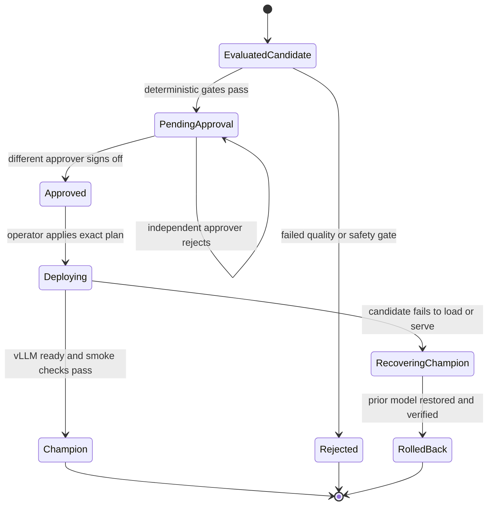

# Single-GPU LLM Release Design

**Status:** PR #54 implements and tests local immutable manifest, plan digest,
stale-input, and independent-approval record primitives. PR #55 adds an authenticated
gateway planning/approval API that reads a finished sanitized MLflow run and stores
the exact manifests in a shared single-host SQLite volume; all five checks passed on
the latest recorded PR head. PR #56 prepares a host-only sequential deployment
controller with simulated subprocess and HTTP tests; no live GPU or EC2 deployment,
recovery, or rollback has run. PR #52 adds the private MLflow service and report
upload path. **Reviewed:** 2026-11-27.

## Why the current release flow cannot deploy the GPU model

The existing release API and database support the local ONNX classifier. The API
hardcodes that model name, its `champion` and `candidate` aliases, and two ONNX target
names. It publishes canary weights to Redis. The dedicated GPU profile instead has
one vLLM endpoint and one served-model alias. Giving two names different weights when
both names point to the same vLLM process would not create a real canary; loading two
large models concurrently would also violate the one-L4 capacity constraint.

PR #52 adds a small MLflow tracking server to the GPU Compose profile and lets the
evaluator upload its sanitized report. The GPU host has its own temporary SQLite and
artifact volume. PR #54 adds the local data/control layer. PR #55 adds authenticated
planning and approval endpoints and checks candidate provenance against the MLflow
run. The caller still supplies the champion manifest and model artifact digest to the
planning API; the API does not prove the currently running champion or recompute
model-file hashes. PR #56 adds a host-only controller that checks the approved
champion against private active state, verifies the running container's image,
arguments, model-cache volume and readiness, then hashes every file in the pinned
snapshot. It performs a sequential restart and attempts verified rollback. These
paths have only been exercised with local fakes; no live deployment or recovery has
occurred.

Keep the existing ONNX flow unchanged. Add a separate LLM release path that records
model artifacts and uses a sequential vLLM restart on the single L4.

## Proposed release record

Store a small deployment manifest in MLflow for each model version. The model weights
remain in the approved Hugging Face source; the manifest records their immutable
identity and verification data rather than copying multi-gigabyte weights into the
MLflow artifact store.

The manifest should include:

- model repository and immutable revision;
- model license and artifact digest;
- vLLM image digest and runtime configuration;
- evaluation suite digest, sanitized report digest, deterministic gate, and human
  review outcome;
- source commit and creation time;
- the deployment alias (`champion` or `candidate`).

Never store prompts, completions, bearer tokens, or private model files in the report
or public Git. Keep only the sanitized evaluation evidence and artifact provenance in
the registry.

## Proposed state machine

An immutable plan must bind the current champion manifest digest, candidate manifest
digest, model image digest, complete vLLM configuration, evaluation report digest,
approval identity, and target environment. Reject a stale plan if the current
champion, candidate, runtime image, or configuration changes after approval.

## Sequential deployment on one L4

The operator applies the approved plan through the EC2 host's private control path:

1. Verify the plan digest, approval identity, current champion, runtime image, free
   disk, and expiry/cost reserve.
2. Preserve the currently deployed manifest and Compose environment as the rollback
   target. Do not remove the model cache or old manifest.
3. Stop the one vLLM server and start it with the candidate model revision and
   approved configuration. This causes a service interruption while the model
   reloads; it is not zero-downtime deployment.
4. Wait for vLLM readiness, confirm the served model identity, and run a small
   non-sensitive smoke request through the gateway.
5. If checks pass, the current host controller records the new champion in its private
   active-state file and retains the previous transaction record. It does not update
   an MLflow model alias or upload a deployment run; those remain follow-up work.
6. If load, readiness, or smoke checks fail, restore the prior configuration, restart
   vLLM, and verify the old champion before marking the plan rolled back. Keep the
   candidate failure logs and do not mark it successful.

The two gateway replicas remain on the same EC2 instance and share one vLLM server.
They provide application-level concurrency, not infrastructure high availability.
No traffic-weighted canary or simultaneous model load is claimed.

## MLflow placement and storage

PR #52 configures one small MLflow tracking service inside the private GPU Compose
network, backed by a temporary SQLite database and encrypted EBS-backed artifact
directory. Its host UI/API mapping is loopback-only for Systems Manager forwarding;
the AWS security group still has no inbound rules. Include the extra container's
system-memory and disk use in the 16-GiB host capacity check. Export sanitized
evidence before termination because the root volume is disposable. The L4 and
model-serving process do not need a managed registry service.

SQLite and one host are suitable only for this short laboratory. A production system
would use a highly available metadata database, durable object storage, access
controls, audit retention, and a deployment controller that safely manages model
replacement across multiple serving replicas.

## Implementation acceptance criteria

- [x] Static Compose and evaluator configuration targets a private MLflow tracking
  server; a live MLflow/model-registry request still requires the L4 batch.
- [x] Local code binds a candidate's full model revision, artifact digest, runtime
  image digest/configuration, evaluation suite/report digests, and source commit into
  a deployment manifest.
- [x] Local code rejects failed deterministic evaluation, unpinned runtime images,
  multi-GPU configuration, manifest tampering, and stale champion/candidate inputs.
- [x] A local SQLite approval journal rejects self-approval and preserves the
  independently approved actor; this does not yet prove authenticated API identity.
- [x] The gateway API derives requester/approver from `platform.admin` and
  `release.approve` dependencies and reads the finished sanitized report from the
  actual MLflow run ID supplied in the candidate request.
- [x] The host controller compares the approved champion to private host state,
  verifies live container image/arguments/cache volume/readiness, and hashes every
  file in each pinned model snapshot before deployment and after startup.
- [x] A host-only controller sequences vLLM replacement, checks readiness, records a
  private transaction journal, and attempts to restore the prior champion if candidate
  deployment fails. Fake-based tests cover success and verified rollback.
- [ ] Validate deployment, interrupted-transaction recovery, automatic rollback, and
  recovery from rollback failure on the authorized L4 host.
- [ ] Plan and candidate records must be linked to a model artifact whose bytes are
  independently checked against the recorded digest.
- A sanitized evaluation report is linked to a pinned model revision and runtime
  image digest.
- A deterministic failing candidate is rejected before approval or deployment.
- A different approver can approve an immutable plan; the requester cannot approve
  their own plan.
- A stale plan is rejected.
- A successful sequential candidate deployment is verified through vLLM and the
  gateway.
- A controlled failed candidate restores the known-good champion and is independently
  verified.
- All controls use the one L4 and account for the service interruption; no concurrent
  canary, multi-GPU, or HA claim is made.

The checked local record/approval items still do not prove an authenticated release,
deployment, or rollback. Runtime release evidence requires the authorized L4 batch
and must fit the $25 ceiling.
